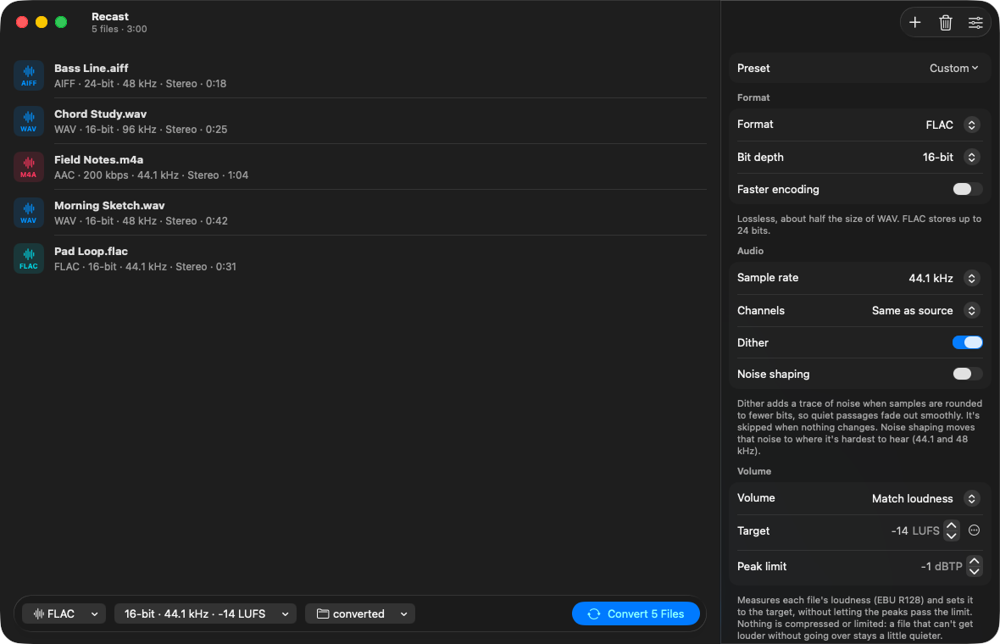
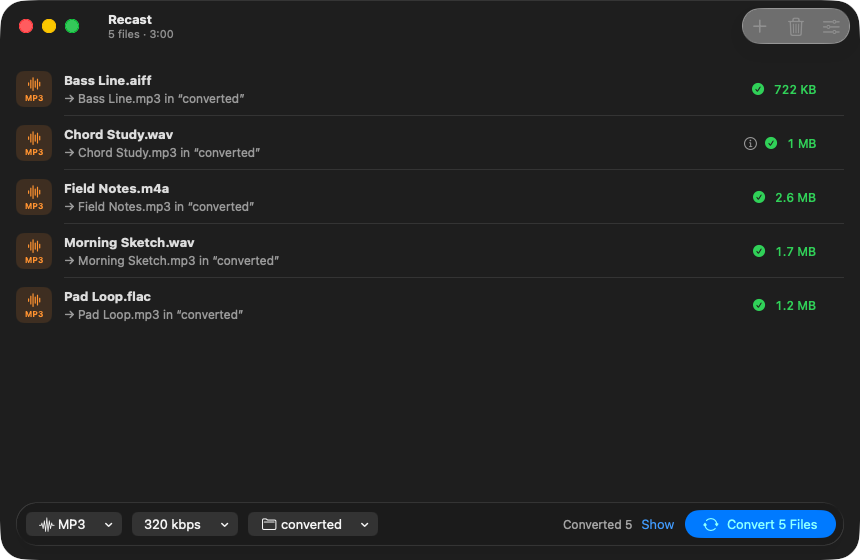
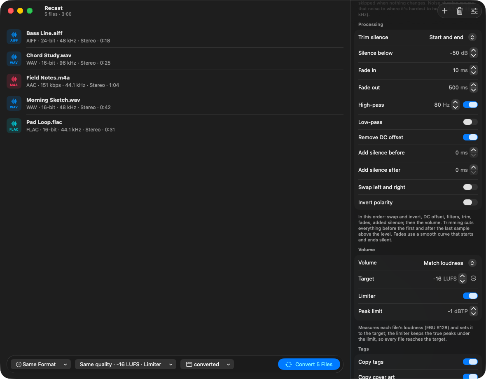
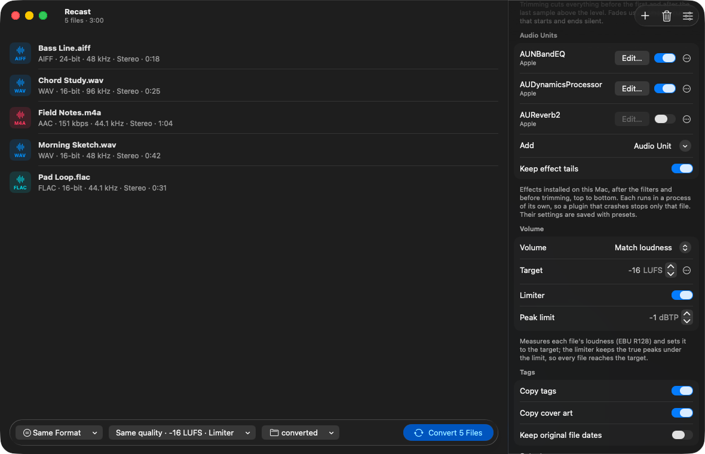
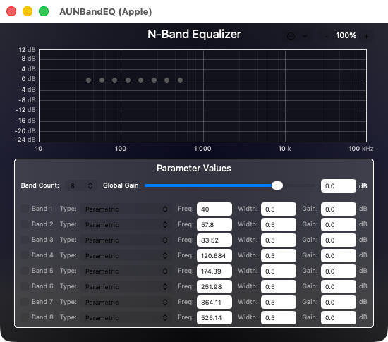

# Recast

A macOS app (SwiftUI, Liquid Glass) for converting and batch-processing audio files. Drop files or whole folders
on the window (or the Dock icon), pick a format, press **Convert**. Everything else is optional: Recast can also
trim, fade, filter, level and limit every file on the way, line up one-shots for layering, run it through Audio Unit
effects, or keep each file's format and only process it.

- **Bottom bar**: the format (or **Same as Source**), a quality menu with the usual choices for that format, and where the files go
  (**Next to Originals** or a folder, with recent folders, "keep folder structure" and what to do when a file
  already exists). **Convert** converts every file in the list; **Stop** ends a batch (⌘.).
- **Settings** (toolbar button or ⌥⌘I) holds the rest, grouped: format options, sample rate, channels,
  dither, processing, Audio Units, volume and limiter, tags, output folder and file-name pattern. **Preset** at the top applies a built-in or saved
  preset, or saves the current settings (format and sound only; where files go stays as it is).
- Each row shows the file's format, bit depth, rate, channels and length. After converting it shows the new
  file and its size; an ⓘ lists anything worth knowing (resampled because the format required it, level
  changes, silence trimmed, how hard the limiter worked, clipping). Right-click a row to show or play the converted file.
- Up to eight files convert at once. Originals are never changed or replaced: output goes to a hidden temporary
  file next to its destination and is moved into place when finished; a name that would replace an original
  or another file in the batch gets a number ("Song 2.mp3").

<picture>
  <source media="(prefers-color-scheme: light)" srcset="docs/screenshots/settings.png">
  
</picture>

<picture>
  <source media="(prefers-color-scheme: light)" srcset="docs/screenshots/converted.png">
  
</picture>

*Screenshots show generated test tones; GitHub shows the light or dark set to match your theme.*

Recast's own code is open source under the GNU General Public License, version 3 or later (`LICENSE`).
Copyright (C) 2026 omso. The bundled encoders keep their own licences: LAME 3.100 is under the GNU LGPL
version 2 (`Packages/Lame/Sources/CLame/COPYING`), and libogg and libvorbis are under Xiph.Org's BSD-style
licence (`Sources/COggVorbis/libvorbis-1.3.7/COPYING`).

LAME is built as its own dynamic library, `libmp3lame.dylib` (`Packages/Lame`), which the app carries in
`Contents/Frameworks` and links at launch; Recast's own binary contains none of LAME's code. Anyone can swap in
their own build of LAME 3.100's interface (universal like the bundled one, or at least for their Mac's processor;
then re-sign the app). The app also carries LAME's licence (`LAME-COPYING.txt`) and `LAME-NOTICE.txt`, which says
where the exact source is, as the LGPL asks.

## Download

Download the newest preview from the [Releases page](https://github.com/kitedrake/recast/releases): the
`Recast-<version>.zip` file under **Assets**. It needs macOS 26 or later and runs on
both Apple silicon and Intel Macs.

**Preview build.** Recast isn't signed or notarized by Apple yet, so macOS warns about it the first time you open
it. To open it anyway:

1. Unzip the download and move Recast to your Applications folder.
2. Open Recast. When macOS says it can't verify the app, click **Done**.
3. Open **System Settings › Privacy & Security**, scroll down to **Security** and click **Open Anyway** next to the
   message about Recast. The button shows for about an hour after you tried to open the app.
4. Confirm with **Open Anyway** and your password or Touch ID when macOS asks. From then on, Recast opens normally.

On current macOS, right-clicking the app and choosing **Open** no longer skips this warning. If you prefer Terminal:
`xattr -dr com.apple.quarantine /Applications/Recast.app`

## Formats

| Format | Written by | Options | Tags written |
| --- | --- | --- | --- |
| WAV | Core Audio | 16, 24, 32-bit, 32-bit float; RF64 above 4 GB | LIST/INFO and an ID3v2.3 chunk (cover art) |
| AIFF | Core Audio | 16, 24, 32-bit; 32-bit float as AIFF-C | name/author/copyright/annotation and an ID3v2.3 chunk (cover art) |
| FLAC | Core Audio | 16, 24-bit; faster or smaller | Vorbis comments and a picture block |
| Apple Lossless (.m4a) | Core Audio | 16, 24, 32-bit | iTunes tags and cover art |
| CAF | Core Audio | 16, 24, 32-bit, 32-bit float | Core Audio's info chunk (no cover art) |
| MP3 | LAME 3.100 | constant, average or variable bit rate (V0–V9), joint stereo | ID3v2.4 with cover art; LAME/Xing header for length and gapless playback |
| AAC (.m4a) | Core Audio | AAC-LC or HE-AAC; constant, average, constrained-variable or variable (quality) | iTunes tags and cover art |
| Ogg Vorbis | libvorbis 1.3.7 | quality −1 to 10, or average bit rate | Vorbis comments, cover art as METADATA_BLOCK_PICTURE |
| Opus (.opus) | Core Audio's Opus encoder, Ogg pages by libogg | 6–510 kbps | OpusTags, cover art as METADATA_BLOCK_PICTURE |

Anything macOS can decode can be converted: WAV/BWF/RF64/Wave64, AIFF, CAF, FLAC, Apple Lossless, MP3, MP2,
AAC/HE-AAC, Ogg Vorbis, Opus, AC-3/E-AC-3, AMR, Sound Designer II, µ-law and A-law. Tags are read from ID3v2.2–2.4
and ID3v1, Vorbis comments (FLAC, Ogg), iTunes MP4 tags, WAV INFO/ID3 chunks, AIFF text/ID3 chunks and CAF info.
The common fields carry across (title, artist, album, album artist, composer, genre, date, track and disc
numbers, comment, lyrics, copyright, ISRC, grouping, BPM, compilation, cover art) plus any other text tags
(MusicBrainz IDs, ReplayGain…). ReplayGain and iTunNORM values are dropped when Recast changes the level.

### Sound

- **Sample rate**: Core Audio's mastering-quality converter. Formats with fixed rates (MP3, AAC, Vorbis up to
  48 kHz; Opus always 48 kHz) use the closest allowed rate of the same family (88.2 kHz → 44.1 kHz) and say so.
- **Channels**: same as source, mono (average) or stereo. Surround is mixed down with ITU levels (centre and
  surrounds at −3 dB, LFE left out) assuming WAV channel order. MP3, AAC and Opus hold two channels at most.
- **Bit depth**: rounding to fewer bits uses TPDF dither (optionally with 3-tap noise shaping at 44.1/48 kHz).
  Dither is skipped when nothing changes, so a 16-bit WAV → FLAC → WAV round trip is bit-exact.
- **Volume**: match loudness (EBU R128 / ITU-R BS.1770-4, measured on the processed signal) with a true-peak limit,
  normalize sample peaks, or a fixed change. On its own this is gain only: a file that can't reach the loudness
  target without passing the peak limit stays quieter, and the row says by how much.
- **Limiter** (optional, after the volume change): keeps true peaks (4× oversampled, as BS.1770 measures them) under
  the peak limit. It looks 5 ms ahead so it turns the level down smoothly before each peak, recovers over about
  80 ms, applies the same reduction to every channel, and adds no delay. With Match loudness every file reaches the
  target: Recast measures what the limiter took off and makes up for it in one more pass.

### Processing

<picture>
  <source media="(prefers-color-scheme: light)" srcset="docs/screenshots/processing.png">
  
</picture>

Optional steps between channel mixing and the volume change, always in this order:

1. **Swap left and right**, **invert polarity**.
2. **Remove DC offset**: a 5 Hz first-order high-pass that starts from the file's opening level, so an offset at
   the start doesn't thump. The row says how large the offset was.
3. **High-pass** and **low-pass**: fourth-order Butterworth (24 dB per octave, −3 dB at the set frequency). A
   frequency too high for the sample rate is skipped, with a note.
4. **Audio Units**: effects installed on the Mac, top to bottom (see below).
5. **Trim silence** at the start, the end or both: everything before the first and after the last sample at or
   above the level (−60 dB unless set) goes. A file that's quiet throughout is left alone, with a note. With
   **Align for layering**, the start moves back to the zero crossing before the hit and the file may be turned over
   (see below).
6. **Fade in** and **fade out**: a raised-cosine curve, silent at the very first and last sample.
7. **Add silence** before and after.

**Align for layering** is for one-shots (hits, footsteps, drum samples) that get played or stacked together, so
they add up instead of partly cancelling. It turns on DC offset removal and trimming at the start, and then:

- starts each file on the zero crossing just before the hit, up to 10 ms before the first sample above the level
  (plain trimming starts on that sample, which can be partway up a swing, and click);
- turns files over whose first strong swing goes down, so it goes up in every file (down with **Invert polarity**).
  The first strong swing is the first sample of the opening 50 ms at half its peak or more, from the channels'
  average. A file whose opening is more than 12 dB under its loudest point (a swell or an ambience, not a hit) keeps
  its polarity, with a note.

Turning a sound over doesn't change how it sounds on its own, only how it combines with others. Layers still
interact through their pitch and timing, so the final blend is up to the ear.

Trimming and fading out read each file once before converting it to find where its sound ends, and matching
loudness or peaks reads it once more, so these are slower than a plain conversion (about 2.5× for a 5-minute file
with everything on).

### Audio Units

<picture>
  <source media="(prefers-color-scheme: light)" srcset="docs/screenshots/plugins.png">
  
</picture>



**Add › Audio Unit** in the Audio Units section lists every effect installed on the Mac (Audio Units of the effect
and music-effect types), by manufacturer. Each one in the list has **Edit…**, which opens the plugin's own window
(or plain controls built from its parameters when it has none), an on/off switch, and a menu to move or remove it.
Its settings are saved with Recast's settings and presets, and taken from open plugin windows before converting.

- Each plugin runs in a process of its own (macOS's Audio Unit hosting): one that crashes stops only that file,
  Intel-only plugins work on Apple silicon, and the signed app needs no exception to load other developers' code.
  A plugin that can't run that way is loaded into Recast itself; in the signed release that works only for Apple's
  own effects.
- Plugins run once per file, rendering offline into a temporary 32-bit float file that the later passes (trimming,
  loudness) read, so slow plugins don't run twice and plugins with random modulation are measured as they sound.
- Each plugin's reported delay is taken out, so the result lines up with the source. With **Keep effect tails**,
  reverbs and echoes ring out after the end (as long as the plugin reports, at most 30 seconds); trim the end to
  drop what's inaudible. Without it, files keep their length.
- Plugins that follow the host's tempo get 120 BPM in 4/4, playing from the start of each file.
- A file fails, with the reason in its row, when a plugin isn't installed (presets from another Mac) or can't
  process the file's channels or sample rate; Recast doesn't quietly leave a plugin out.

**Same as Source** keeps each file's format instead of converting: lossless files keep their bit depth, compressed
files are encoded again at about their bit rate (and lose a little quality, as any re-encoding does; the row says
so). Files in a format Recast doesn't write are saved as WAV (Wave64, AU, Sound Designer II) or FLAC (MP2, AC-3
and the rest). Next to the originals, the new files get a number ("Song 2.mp3").

Built-in presets for processing: **Loudness Fix** (same format, −14 LUFS, limiter), **Voice Clean-up** (MP3 mono,
80 Hz high-pass, trimmed, −16 LUFS, limiter) and **Game Sounds** (16-bit WAV at 48 kHz, trimmed and aligned for
layering, a short fade-out, peaks at −1 dB).

## Build and run

```sh
./build.sh                       # builds build/Recast.app (universal, ad-hoc signed, local use)
open build/Recast.app
```

Requires macOS 26 (Liquid Glass) and Xcode 26 or newer; the script uses Xcode's toolchain. The icon is drawn by
`icon/make_icon.swift`; run `icon/make-icns.sh` to rebuild `Resources/AppIcon.icns`.

### With omso Builder

The repository describes its build in `omso-build.json`: `build.sh`, the engine tests (`test.sh`), then
`Recast --self-test`, which converts a generated, tagged 24-bit file to every format and checks lengths, tags,
cover art, bit-exact lossless audio, loudness matching, processing (trim, fades, filters, limiter) and Audio Units
(Apple's sample delay and peak limiter in a chain). **Build & Install** copies `Recast.app` into
`/Applications/omso`.

Command line (same engine, no window):

```sh
build/Recast.app/Contents/MacOS/Recast --convert FILE|FOLDER… --format mp3 [--out FOLDER] [--bitrate 320] …
build/Recast.app/Contents/MacOS/Recast --convert ~/Music/Album --preset podcast --out ~/Desktop/Episodes
build/Recast.app/Contents/MacOS/Recast --convert ~/Takes --format same --trim -55 --highpass 80 --loudness -16 --limit -1 --out ~/Desktop/Clean
build/Recast.app/Contents/MacOS/Recast --convert ~/SFX/Impacts --format wav --bits 16 --trim -60 --align --peak -1 --out ~/Desktop/Layers
build/Recast.app/Contents/MacOS/Recast --list-au          # installed Audio Unit effects
build/Recast.app/Contents/MacOS/Recast --convert ~/Stems --format wav --au "AUNBandEQ" --au-preset Tilt.aupreset --au "Apple: AUReverb2" --keep-tails
build/Recast.app/Contents/MacOS/Recast --info FILE…        # format, loudness, true peak and tags
build/Recast.app/Contents/MacOS/Recast --self-test FOLDER
build/Recast.app/Contents/MacOS/Recast --help              # every option
```

## Updates and releases

Released copies update themselves with [Sparkle](https://sparkle-project.org) 2.10.1 (pinned in
`Package.swift`). A plain `./build.sh`, and omso Builder's builds, have no update feed: they never check for
updates and show no update menu items.

A release build gets its feed and key from the environment; the release tool in the `software-site` repository
sets them:

| Variable | What it does |
| --- | --- |
| `UPDATE_FEED_URL` | the update feed, `<site>/updates/recast/appcast.xml` |
| `UPDATE_PUBLIC_KEY` | the EdDSA public key; an update signed with any other key is refused |
| `SIGN_IDENTITY` | codesign identity: a Developer ID for releases (default: ad-hoc) |

Such a build has **Check for Updates…** and **Check for Updates Automatically** in the app menu. Sparkle
asks on the second launch whether to check automatically, and sends nothing before that. A check downloads the
feed from the site; the request names the app and its version, and system profiling stays off, so nothing about
the Mac is sent (the server sees the IP address, as with any web request).

To release: bump `VERSION` and push it, then push an annotated tag whose message is the release notes, one note per
line:

```sh
git tag -a v1.2.3 -m "First note" -m "Second note" && git push origin v1.2.3
```

The Release workflow (`.github/workflows/release.yml`) runs `scripts/release-ci.sh` on a GitHub Mac: it builds with
the update feed, runs the tests and the self-test, signs and notarizes the app when the Apple secrets are set, signs
the update when `SPARKLE_PRIVATE_KEY` is set, and publishes a GitHub release with the zip and `update.json` (a
pre-release until it's notarized). kitedrake.com then lists it for download and, once it's signed and notarized, in
the update feed. A push to `main` that changes the workflow or the script does a dry run without publishing.
`scripts/release-ci.sh` is the same file in every Kitedrake app repository: change all copies together. `sh
scripts/test-update.sh recast` in the site repository tests a real update end to end with a throwaway key, including
refusing an update signed with another key. Sparkle's XPC services are left out of the app because Recast isn't
sandboxed.

## Tests

```sh
./test.sh                        # xcrun swift test with Xcode's toolchain; extra arguments are passed on
```

The tests generate their own audio in temporary folders (deleted afterwards; `RECAST_KEEP_TEST_FILES=1` keeps
them) and check: bit-exact lossless round trips in every lossless format, dither noise levels, compressed formats
against the source (correlation and alignment), resampling, channel mixing, loudness measurement against the
BS.1770 reference tone and normalization, clipping reports, tags and cover art through every format, M4A chunk
offsets when large cover art moves the audio, very short files, file naming and collisions, and settings storage.
Processing tests check trimming to the exact sample, fade curves and added silence, filter response at and around
the set frequency, DC offset removal, swapping and inverting, aligning for layering (a thump that swings down and
the same thump turned over come out identical, starting on the zero crossing; Invert polarity; swells left alone),
the limiter (true peak under the limit, no delay,
untouched below the limit), loudness with the limiter reaching its target, processing in every format, Same as
Source, and presets saved before processing existed. Audio Unit tests use Apple's own effects: settings reaching
the plugin exactly (a 100-sample delay), plugin delay taken out, plugins running before trimming, tails cut or
kept, bypassed plugins left out, a missing plugin stopping the file, and plugin settings surviving storage.

## Known limits

- Decoding is Core Audio's: WMA, APE, WavPack, DSD and Matroska/WebM files aren't read.
- Core Audio's FLAC encoder offers two speeds rather than levels 0–8. It writes a broken file for audio shorter
  than one FLAC block (4608 samples, about 0.1 s), so Recast writes those itself as one uncompressed FLAC frame;
  files under 16 samples are valid FLAC but macOS can't open them.
- When macOS decodes Ogg Vorbis written by Recast, the audio comes out 128 samples (3 ms) early. The files come
  straight from libvorbis; other players haven't been checked.
- CAF files get no cover art (Core Audio's info chunk has no field for it). WAV tags are skipped for RF64 files.
- If `libmp3lame.dylib` is missing from the app, macOS won't start it (the library is linked, not loaded on
  demand).
- Audio Units only: effects, not instruments or format converters (time stretch, pitch). VST3 plugins aren't
  hosted. A plugin that misreports its delay or tail comes out shifted or cut; one that shows a licence or
  activation window may refuse to process until it's set up in its own window.

## Layout

```text
Sources/RecastCore/         engine, no UI
  Model.swift               formats, settings, presets
  QualityChoices.swift      the quick quality menu for each format
  Probe.swift               reading file details; decoding and resampling (ExtAudioFile)
  DSP.swift                 channel mixing, dither and noise shaping
  Loudness.swift            BS.1770 loudness, sample and true peak
  Effects.swift             processing: swap/invert, DC, filters, trim, fades, silence, limiter
  Plugins.swift             Audio Units: finding, loading out of process, offline rendering, saved settings
  SameFormat.swift          "Same as Source": each file's own format and about its bit rate
  Converter.swift           one file: plan, scan, analyse, process, encode, tag, move into place
  OutputPlanner.swift       output names and folders, collisions, folder scanning
  Encoders/                 Core Audio, FLAC (short-file fallback), LAME MP3, libvorbis and Opus-in-Ogg
  Tags/                     ID3, Vorbis comments/FLAC, MP4, WAV/AIFF chunks
Packages/Lame/              LAME 3.100 encoder, vendored unmodified (see OMSO_PROVENANCE.md), built as
                            libmp3lame.dylib; NOTICE.txt goes into the app
Sources/COggVorbis/         libogg + libvorbis 1.3.7 as bundled with JUCE (see OMSO_PROVENANCE.md)
Sources/Recast/             SwiftUI app: list, bar, settings, plugin windows, command line, self-test, snapshots
Tests/RecastCoreTests/      generated fixtures and engine tests
```
